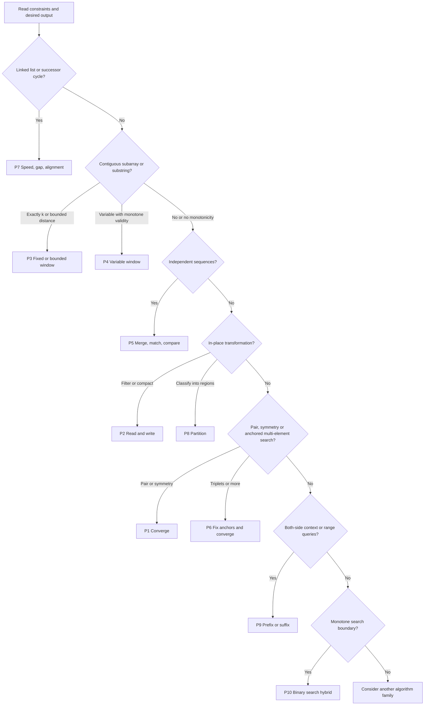

# Two Pointers Mastery Guide — Corrected C++17 Edition (v3)

> Goal: learn transferable invariants and pointer movement rules, not memorize answers. This guide covers all questions in the supplied main inventory. No percentage of interview coverage is claimed.

## How to use this guide

Read the recognition guide, study a pattern's invariant and templates, then solve its core questions before moving to variants. Reproduce the algorithm, explain why each pointer move is safe, dry-run it, and state time and auxiliary space complexity.

**Scope:** C++17; snippets are standalone functions intended for practice, with standard headers and `using namespace std;` assumed. Linked-list templates assume the usual `ListNode` definition. Templates are illustrative rather than a full tested LeetCode submission for every listed problem. Complexity excludes returned output unless explicitly stated; sorting time and typical C++ sorting-stack space are included where relevant. Hash-table bounds are expected, not guaranteed worst-case.

## Contents

- [Pattern distribution](#distribution)
- [Recognition and decision guide](#recognition)

- [P01 — Opposite Ends (Converging)](#p01)

- [P02 — Read / Write Pointers (Forward and Backward)](#p02)

- [P03 — Sliding Window — Fixed Size](#p03)

- [P04 — Sliding Window — Variable Size](#p04)

- [P05 — Two Sequences — Merge, Match & Intersect](#p05)

- [P06 — K-Sum & Multi-Pointer](#p06)

- [P07 — Linked List & Floyd Pointer Techniques](#p07)

- [P08 — Partitioning & Dutch National Flag](#p08)

- [P09 — Prefix / Suffix & Bidirectional Passes](#p09)

- [P10 — Binary Search & Boundary Search](#p10)

- [Cross-pattern and relocation register](#cross-pattern)
- [30-day roadmap](#roadmap)
- [Priority 30](#priority)
- [Common mistakes and review checklist](#checklist)
- [Supplementary problem and image inventory](#inventory)

<a id="distribution"></a>
## Pattern distribution


The source contains 122 question entries in its ten main lists, representing 109 distinct LeetCode IDs. The revised counts below count each problem exactly once. LC 84 appears only in the source roadmap; QuickSort partition appears in the must-solve table. Both are preserved separately. Six materially different cross-pattern alternative algorithms are tracked separately. Of the 109 main-list IDs, 107 are assigned to algorithm families and two (1822, 2231) are retained as supplementary material in P8, not presented as partition problems. Counts include these two for source reconciliation.

| Pattern | Family | Source entries | Revised primary questions | Alternate solutions in folder |
|---|---|---:|---:|---:|
| P01 — Opposite Ends (Converging) | Core | 15 | 14 | 0 |
| P02 — Read / Write Pointers (Forward and Backward) | Core | 11 | 7 | 0 |
| P03 — Sliding Window — Fixed Size | Window | 14 | 14 | 0 |
| P04 — Sliding Window — Variable Size | Window | 25 | 25 | 0 |
| P05 — Two Sequences — Merge, Match & Intersect | Core | 12 | 12 | 0 |
| P06 — K-Sum & Multi-Pointer | Core | 9 | 8 | 0 |
| P07 — Linked List & Floyd Pointer Techniques | Core | 10 | 10 | 0 |
| P08 — Partitioning & Dutch National Flag | Core | 9 | 7 | 0 |
| P09 — Prefix / Suffix & Bidirectional Passes | Complementary / hybrid | 9 | 9 | 1 |
| P10 — Binary Search & Boundary Search | Complementary / hybrid | 8 | 3 | 5 |
| **Total** | | **122** | **109** | **6** |

**Complexity notation:** n and m are input lengths unless otherwise specified; k is a window/constraint; d is distinct values (or digit count for 2231); σ is alphabet size; R and C are matrix dimensions; q is query count. Sorting space refers to typical in-place C++ introsort implementations, not a standard-mandated bound. Hashing bounds are expected. Input copying is excluded: read-only string inputs should be passed by const reference.

**Labels:** Core = directly follows a pattern invariant; Variation = modifies that invariant's implementation; Hybrid = combines it with another technique; Slightly different / supplementary = not a direct fit. A separate **Moved from** marker indicates reclassification from the supplied list. P9 and P10 are complementary techniques, not traditional two-pointer algorithms.

<a id="recognition"></a>
## Recognition and decision guide

Use the dominant invariant, not keywords alone. Several approaches may be valid. Ask whether you may reorder input, whether positions are important, and whether each pointer move provably eliminates candidates.



| Recognition signal | First approach to consider | Check before applying |
|---|---|---|
| Sorted pair target | P1 | Sorting must preserve needed information |
| Mirror or reversal | P1 | No sorting; preserve order |
| Remove, compress, overwrite | P2 | No unread data overwritten |
| Exactly k consecutive | P3 | Correct initial window; update state |
| Longest, shortest or count of contiguous ranges | P4 | Monotone validity; negatives may break sum windows |
| Merge, match, compare sequences | P5 | Know what equality means |
| Triplets / k-sum | P6 | Safe sorting, duplicate policy |
| Cycle, middle, kth-from-end | P7 | Null checks or valid successor function |
| Rearrange groups | P8 | Stability and memory constraints |
| Except self, both sides, range query | P9 | Inclusive vs exclusive prefix |
| Ordered boundary / feasible answer | P10 | Monotonicity and strictness |

<a id="p01"></a>
## P01 — Opposite Ends (Converging)

**Family:** Core · **Primary problems:** 14 · **Alternate solutions:** 0

### Notes & theory

**What it is:** Two endpoints delimit the remaining search space; each move must safely eliminate candidates or complete a symmetric operation.

**Recognition signals:** Sorted sums, symmetric strings, boundary-based optimization. Sorting is required for monotone sum comparisons, not for palindrome, reversal, container or water.

**Invariant / why it works:** For sorted a, if a[l]+a[r]<target, no pair using l and any index <=r can meet target. The analogous argument eliminates r for too-large sums. For greedy geometry, prove a different elimination rule.

**TC / SC:** O(n) scan and O(1) auxiliary; sorting if needed adds O(n log n) time and typical O(log n) stack; output and power tables vary.

**Pitfalls:** Do not sort when positions/order matter; count r-l only for a proven monotone block; use long long for sums/products.

### Worked example and transfer rule

**Dry run:** 167: a=[1,2,4,7,11], target=9. (l,r)=(0,4):12>9 -> r=3. Sum 8<9 -> l=1. Sum 9 -> return [2,4] (1-based).

**Transfer rule:** For sorted sum, removing the smaller endpoint is safe only when even its largest available partner is too small. For container/water and symmetry, use their own invariant.

### Reusable C++ templates

#### Sorted pair search (LC 167; returns 1-based positions)

```cpp
vector<int> twoSum(vector<int>& a, int target) {
    int l=0, r=(int)a.size()-1;
    while (l<r) {
        long long sum=1LL*a[l]+a[r];
        if (sum==target) return {l+1,r+1};
        if (sum<target) ++l;
        else --r;
    }
    return {};
}
```

#### Boundary optimization (LC 11)

```cpp
int maxArea(vector<int>& h) {
    int l=0,r=(int)h.size()-1,best=0;
    while (l<r) {
        best=max(best,(r-l)*min(h[l],h[r]));
        if (h[l]<=h[r]) ++l;
        else --r;
    }
    return best;
}
```

#### Valid Palindrome (LC 125; skip punctuation and normalize case)

```cpp
bool palindrome(const string& s) {
    int l=0,r=(int)s.size()-1;
    while(l<r) {
        while(l<r && !isalnum((unsigned char)s[l])) ++l;
        while(l<r && !isalnum((unsigned char)s[r])) --r;
        if(tolower((unsigned char)s[l])!=tolower((unsigned char)s[r])) return false;
        ++l; --r;
    }
    return true;
}
```

#### Trapping Rain Water (LC 42)

```cpp
int trap(vector<int>& h) {
    int l=0,r=(int)h.size()-1,L=0,R=0,water=0;
    while(l<=r) {
        if(L<=R) {
            L=max(L,h[l]);
            water+=L-h[l++];
        } else {
            R=max(R,h[r]);
            water+=R-h[r--];
        }
    }
    return water;
}
```

#### Count sorted pairs below target (LC 2824, input may be reordered)

```cpp
long long countPairsBelow(vector<int>& a, long long target) {
    sort(a.begin(),a.end());
    int l=0,r=(int)a.size()-1; long long ans=0;
    while(l<r) {
        if(1LL*a[l]+a[r]<target) { ans+=r-l; ++l; }
        else --r;
    }
    return ans;
}
```

### Subpattern distribution and all questions

A star (★) marks a question starred in the original source; see the priority section for a smaller learning sequence. Each row maps the specific algorithm to its family, with time and auxiliary space for the stated approach (excluding returned output).

#### 1.1 — Target and pair search

| LC ID | Problem | Classification | Common logic / specific variation | Source mapping  TC | Auxiliary SC |
|---:|---|---|---|---|---|---|
| 167 | ★ Two Sum II — Input Array Is Sorted | Core | Sorted sum: advance left if too small, right if too large. | Also in P10 | O(n) | O(1) |
| 1099 | Two Sum Less Than K | Variation | Track best sum strictly below K; move left on valid sum. | Also in P6 | O(n log n) | O(log n) |
| 1679 | Max Number of K-Sum Pairs | Variation | Sort; consume both ends on a matching sum to form disjoint pairs. | Retained | O(n log n) | O(log n) |

#### 1.2 — Pair / subsequence counting

| LC ID | Problem | Classification | Common logic / specific variation | Source mapping  TC | Auxiliary SC |
|---:|---|---|---|---|---|---|
| 2824 | Count Pairs Whose Sum is Less than Target | Variation | Sort; if a[l]+a[r]<target, count r-l pairs and advance l. | Also in P10 | O(n log n) | O(log n) |
| 1498 | ★ Number of Subsequences That Satisfy the Given Sum Condition | Hybrid | Sort; when min+max<=target, add 2^(r-l) modulo M; precompute powers. | Also in P10 | O(n log n) | O(n) |

#### 1.3 — Greedy boundary elimination

| LC ID | Problem | Classification | Common logic / specific variation | Source mapping  TC | Auxiliary SC |
|---:|---|---|---|---|---|---|
| 11 | ★ Container With Most Water | Core | Evaluate area, then discard shorter boundary; a narrower container cannot improve with that same height. | Retained | O(n) | O(1) |
| 42 | ★ Trapping Rain Water | Hybrid | Track left/right maxima; settle the side with smaller known maximum. | Also in P9 | O(n) | O(1) |
| 1877 | Minimize Maximum Pair Sum in Array | Variation | Sort and pair smallest with largest; minimize largest pair sum. | Retained | O(n log n) | O(log n) |

#### 1.4 — Symmetry and reversal

| LC ID | Problem | Classification | Common logic / specific variation | Source mapping  TC | Auxiliary SC |
|---:|---|---|---|---|---|---|
| 125 | ★ Valid Palindrome | Core | Skip non-alphanumeric characters, compare case-insensitively, advance both. | Retained | O(n) | O(1) |
| 344 | Reverse String | Core | Swap ends until pointers meet. | Retained | O(n) | O(1) |
| 345 | Reverse Vowels of a String | Variation | Skip non-vowels; swap vowel pairs. | Retained | O(n) | O(1) |
| 680 | Valid Palindrome II | Variation | On first mismatch, test skipping either endpoint once. | Retained | O(n) | O(1) |
| 1750 | Minimum Length of String After Deleting Similar Ends | Variation | If endpoints match, consume their entire equal-character runs on both sides. | Moved from P2 | O(n) | O(1) |

#### 1.5 — Transform from ends

| LC ID | Problem | Classification | Common logic / specific variation | Source mapping  TC | Auxiliary SC |
|---:|---|---|---|---|---|---|
| 977 | ★ Squares of a Sorted Array | Variation | Compare absolute values and write larger square into output from right to left. | Retained | O(n) | O(1) |

### Recommended first practice

167 (Two Sum II — Input Array Is Sorted), 1498 (Number of Subsequences That Satisfy the Given Sum Condition), 11 (Container With Most Water), 42 (Trapping Rain Water), 125 (Valid Palindrome), 977 (Squares of a Sorted Array).

---

<a id="p02"></a>
## P02 — Read / Write Pointers (Forward and Backward)

**Family:** Core · **Primary problems:** 7 · **Alternate solutions:** 0

### Notes & theory

**What it is:** A reader discovers values; a writer records the valid result. The pointers can move forward or backward.

**Recognition signals:** In-place remove, deduplicate, compress, or expand without overwriting unread input.

**Invariant / why it works:** Forward invariant: the prefix [0,w) is the required output for everything already read; w<=r for compaction. Backward expansion maintains a finalized suffix.

**TC / SC:** O(n) time and O(1) extra space for the templates; returned output excluded.

**Pitfalls:** Do not confuse write index with last valid index. For Move Zeroes, fill trailing positions. Use backward writing for Duplicate Zeros.

### Worked example and transfer rule

**Dry run:** 26: [1,1,2,2,3]. w starts at 0. Keep 1 -> w=1; skip 1; keep 2 -> w=2; skip 2; keep 3 -> w=3. Valid prefix [1,2,3].

**Transfer rule:** The write pointer always points to the next output slot, never the last valid slot. Backward expansion uses a virtual expanded end instead.

### Reusable C++ templates

#### Remove element (LC 27)

```cpp
int removeElement(vector<int>& a,int val) {
    int w=0;
    for(int x:a) if(x!=val) a[w++]=x;
    return w;
}
```

#### At most two copies (LC 80; sorted input)

```cpp
int removeDuplicates(vector<int>& a) {
    int w=0;
    for(int x:a)
        if(w<2 || x!=a[w-2]) a[w++]=x;
    return w;
}
```

#### Move zeroes (LC 283)

```cpp
void moveZeroes(vector<int>& a) {
    int w=0;
    for(int x:a) if(x!=0) a[w++]=x;
    while(w<(int)a.size()) a[w++]=0;
}
```

#### Duplicate zeros (LC 1089; backward write)

```cpp
void duplicateZeros(vector<int>& a) {
    int n=a.size(), j=n-1;
    for(int x:a) if(x==0) ++j;
    for(int i=n-1;i>=0;--i) {
        if(j<n) a[j]=a[i];
        --j;
        if(a[i]==0) {
            if(j<n) a[j]=0;
            --j;
        }
    }
}
```

### Subpattern distribution and all questions

A star (★) marks a question starred in the original source; see the priority section for a smaller learning sequence. Each row maps the specific algorithm to its family, with time and auxiliary space for the stated approach (excluding returned output).

#### 2.1 — Stable filtering / compaction

| LC ID | Problem | Classification | Common logic / specific variation | Source mapping  TC | Auxiliary SC |
|---:|---|---|---|---|---|---|
| 27 | ★ Remove Element | Core | Write each value not equal to val. | Retained | O(n) | O(1) |
| 283 | ★ Move Zeroes | Core | Write nonzero values in order, then fill the remaining positions with zeros. | Also in P8 | O(n) | O(1) |

#### 2.2 — Sorted deduplication

| LC ID | Problem | Classification | Common logic / specific variation | Source mapping  TC | Auxiliary SC |
|---:|---|---|---|---|---|---|
| 26 | ★ Remove Duplicates from Sorted Array | Core | Keep first element and any value different from the last written. | Retained | O(n) | O(1) |
| 80 | ★ Remove Duplicates from Sorted Array II | Variation | Keep if fewer than two written, or value differs from the value two positions back. | Retained | O(n) | O(1) |

#### 2.3 — Run compression

| LC ID | Problem | Classification | Common logic / specific variation | Source mapping  TC | Auxiliary SC |
|---:|---|---|---|---|---|---|
| 443 | String Compression | Variation | Read full equal-character run; write symbol and count digits if count>1. | Retained | O(n) | O(1) |

#### 2.4 — Transform then compact

| LC ID | Problem | Classification | Common logic / specific variation | Source mapping  TC | Auxiliary SC |
|---:|---|---|---|---|---|---|
| 2460 | Apply Operations to an Array | Variation | Apply adjacent equal-value operations left-to-right first; then compact nonzeros. | Retained | O(n) | O(1) |

#### 2.5 — Backward read/write

| LC ID | Problem | Classification | Common logic / specific variation | Source mapping  TC | Auxiliary SC |
|---:|---|---|---|---|---|---|
| 1089 | Duplicate Zeros | Variation | Count virtual expanded length; write from back, duplicating zeros without overwriting unread elements. | Moved from P8 | O(n) | O(1) |

### Recommended first practice

27 (Remove Element), 283 (Move Zeroes), 26 (Remove Duplicates from Sorted Array), 80 (Remove Duplicates from Sorted Array II).

---

<a id="p03"></a>
## P03 — Sliding Window — Fixed Size

**Family:** Window · **Primary problems:** 14 · **Alternate solutions:** 0

### Notes & theory

**What it is:** A contiguous window has exactly k items after initialization; each step adds right and removes the expired left item.

**Recognition signals:** Exactly k consecutive items, fixed-length anagrams, sums, averages, or fixed-window extrema. LC 219 uses a bounded previous-k window, not exactly k.

**Invariant / why it works:** The maintained state describes only the current window. Updating it incrementally avoids recomputing k items per position.

**TC / SC:** O(n) for O(1) updates; frequency maps typically O(k) extra, deque O(k); all binary codes may need O(2^k) space.

**Pitfalls:** Handle k=n and short inputs; compare sums without truncation; extrema require deque or another structure, not a plain running max.

### Worked example and transfer rule

**Dry run:** 643: [1,4,2,5], k=2. Sums: 5 -> 6 -> 7. Max average=7/2=3.5. Each step subtracts the departing value and adds the arriving one.

**Transfer rule:** Never update answer for a partial window. For LC 219, check previous at most k elements before adding current; it is bounded-distance rather than exact length.

### Reusable C++ templates

#### Maximum sum of k consecutive values (1 <= k <= n)

```cpp
long long maxWindow(const vector<int>& a,int k) {
    long long sum=0;
    for(int i=0;i<k;++i) sum+=a[i];
    long long best=sum;
    for(int r=k;r<(int)a.size();++r) {
        sum+=1LL*a[r]-a[r-k];
        best=max(best,sum);
    }
    return best;
}
```

#### Anagram matching (LC 438, lowercase English letters)

```cpp
vector<int> findAnagrams(const string& s,const string& p) {
    vector<int> ans;
    int k=p.size(), n=s.size();
    if(k==0 || k>n) return ans;
    array<int,26> need{}, have{};
    for(char c:p) ++need[c-'a'];
    for(int r=0;r<n;++r) {
        ++have[s[r]-'a'];
        if(r>=k) --have[s[r-k]-'a'];
        if(r>=k-1 && have==need) ans.push_back(r-k+1);
    }
    return ans;
}
```

#### Monotonic deque maximum (LC 239, 1 <= k <= n)

```cpp
vector<int> maxSlidingWindow(vector<int>& a,int k) {
    deque<int> q; vector<int> ans;
    for(int r=0;r<(int)a.size();++r) {
        while(!q.empty() && q.front()<=r-k) q.pop_front();
        while(!q.empty() && a[q.back()]<=a[r]) q.pop_back();
        q.push_back(r);
        if(r>=k-1) ans.push_back(a[q.front()]);
    }
    return ans;
}
```

### Subpattern distribution and all questions

A star (★) marks a question starred in the original source; see the priority section for a smaller learning sequence. Each row maps the specific algorithm to its family, with time and auxiliary space for the stated approach (excluding returned output).

#### 3.1 — Running sum, average and count

| LC ID | Problem | Classification | Common logic / specific variation | Source mapping  TC | Auxiliary SC |
|---:|---|---|---|---|---|---|
| 643 | ★ Maximum Average Subarray I | Core | Maintain sum of exactly k values and maximize; divide by k. | Retained | O(n) | O(1) |
| 1343 | ★ Number of Sub-arrays of Size K and Average Greater than or Equal to Threshold | Core | Compare window sum to k*threshold, not rounded average. | Retained | O(n) | O(1) |
| 2090 | K Radius Subarray Averages | Variation | Use window width 2*k+1 and write average at its center; invalid centers stay -1. | Retained | O(n) | O(1) |
| 2379 | Minimum Recolors to Get K Consecutive Black Blocks | Core | Count white blocks inside each size-k window; minimize count. | Retained | O(n) | O(1) |

#### 3.2 — Frequency matching

| LC ID | Problem | Classification | Common logic / specific variation | Source mapping  TC | Auxiliary SC |
|---:|---|---|---|---|---|---|
| 438 | ★ Find All Anagrams in a String | Core | Compare 26-letter window counts against pattern; emit all matching starts. | Retained | O(n+m) | O(1) |
| 567 | ★ Permutation in String | Core | Same frequency equality, return true on the first match. | Retained | O(n+m) | O(1) |

#### 3.3 — Bounded distance and distinctness

| LC ID | Problem | Classification | Common logic / specific variation | Source mapping  TC | Auxiliary SC |
|---:|---|---|---|---|---|---|
| 219 | Contains Duplicate II | Variation | Keep a hash set of previous at most k indices; check membership before inserting. | Retained | O(n) expected | O(min(n,k)) |
| 2461 | Maximum Sum of Distinct Subarrays With Length K | Hybrid | Maintain size k, sum and counts; accept only k distinct values. | Also in P4 | O(n) expected | O(k) |
| 2841 | Maximum Sum of Almost Unique Subarray | Hybrid | Maintain size k, sum and counts; accept at least m distinct values. | Retained | O(n) expected | O(k) |

#### 3.4 — Monotonic deque

| LC ID | Problem | Classification | Common logic / specific variation | Source mapping  TC | Auxiliary SC |
|---:|---|---|---|---|---|---|
| 239 | Sliding Window Maximum | Hybrid | Expire old indices, pop smaller/equal values from back, read max at front. | Retained | O(n) | O(k) |

#### 3.5 — Complement / bonus window

| LC ID | Problem | Classification | Common logic / specific variation | Source mapping  TC | Auxiliary SC |
|---:|---|---|---|---|---|---|
| 1052 | Grumpy Bookstore Owner | Variation | Add baseline satisfied customers to maximum extra grumpy-window customers. | Retained | O(n) | O(1) |
| 1423 | Maximum Points You Can Obtain from Cards | Variation | Total minus minimum sum of the middle n-k cards; handle k=n. | Retained | O(n) | O(1) |

#### 3.6 — Circular window

| LC ID | Problem | Classification | Common logic / specific variation | Source mapping  TC | Auxiliary SC |
|---:|---|---|---|---|---|---|
| 1652 | Defuse the Bomb | Variation | Use modulo indexing; initialize the next k or previous abs(k) elements, then slide the circular window in O(1) per index; zero if k=0. | Retained | O(n) | O(1) |

#### 3.7 — Binary-code coverage

| LC ID | Problem | Classification | Common logic / specific variation | Source mapping  TC | Auxiliary SC |
|---:|---|---|---|---|---|---|
| 1461 | Check If a String Contains All Binary Codes of Size K | Hybrid | Roll k-bit code, mark distinct codes and check all 2^k codes; reject impossible lengths early. | Retained | O(n+2^k) | O(2^k) |

### Recommended first practice

643 (Maximum Average Subarray I), 1343 (Number of Sub-arrays of Size K and Average Greater than or Equal to Threshold), 438 (Find All Anagrams in a String), 567 (Permutation in String).

---

<a id="p04"></a>
## P04 — Sliding Window — Variable Size

**Family:** Window · **Primary problems:** 25 · **Alternate solutions:** 0

### Notes & theory

**What it is:** Expand the right boundary and advance the left boundary under a problem-specific monotone validity condition.

**Recognition signals:** Longest/shortest contiguous range under a constraint; count valid ranges. Verify that invalid starts can be discarded permanently.

**Invariant / why it works:** Each pointer advances at most n times; if state updates are O(1) amortized the whole pass is linear. A longest window shrinks while invalid; a shortest window records while valid. Counting needs a proof of which starts or ends are valid.

**TC / SC:** O(n) for ordinary windows; expected O(n) with hash maps, O(d) extra for d tracked distinct values; enumeration LC 395 O(26n); sorting hybrids O(n log n).

**Pitfalls:** Negative numbers break many sum-window assumptions. Exactly-k counting is a difference of two nested at-most counts; not a generic trick for every optimization.

### Worked example and transfer rule

**Dry run:** 1004: [1,0,0,1,1], k=1. At r=2 the window has two zeros; remove from left until only one remains (l=2). Extend through r=4 -> [0,1,1], best=3.

**Transfer rule:** Longest: shrink while invalid, then update. Shortest: update while valid, then shrink. Counting: prove a whole block of valid windows before adding its size.

### Reusable C++ templates

#### Longest valid window: at most k zeros (LC 1004)

```cpp
int longestOnes(vector<int>& a,int k) {
    int l=0,zeros=0,best=0;
    for(int r=0;r<(int)a.size();++r) {
        zeros+=a[r]==0;
        while(zeros>k) zeros-=a[l++]==0;
        best=max(best,r-l+1);
    }
    return best;
}
```

#### Shortest valid window (LC 209; positive numbers, target>0)

```cpp
int minSubArrayLen(int target,vector<int>& a) {
    int l=0,n=a.size(),best=n+1;
    long long sum=0;
    for(int r=0;r<n;++r) {
        sum+=a[r];
        while(sum>=target) {
            best=min(best,r-l+1);
            sum-=a[l++];
        }
    }
    return best==n+1?0:best;
}
```

#### Count exactly k distinct via two at-most counts (LC 992)

```cpp
long long atMost(const vector<int>& a,int k) {
    if(k<0) return 0;
    unordered_map<int,int> f;
    int l=0; long long ans=0;
    for(int r=0;r<(int)a.size();++r) {
        ++f[a[r]];
        while((int)f.size()>k) {
            int x=a[l++];
            if(--f[x]==0) f.erase(x);
        }
        ans+=r-l+1;
    }
    return ans;
}
// exactly(k) = atMost(a,k) - atMost(a,k-1)
```

#### Minimum Window Substring (LC 76; byte characters)

```cpp
string minWindow(const string& s,const string& t) {
    if(t.empty()) return "";
    array<int,256> need{};
    for(unsigned char c:t) ++need[c];
    int missing=t.size(),l=0,start=0,best=INT_MAX;
    for(int r=0;r<(int)s.size();++r) {
        if(need[(unsigned char)s[r]]-- > 0) --missing;
        while(missing==0) {
            if(r-l+1<best) {best=r-l+1;start=l;}
            if(++need[(unsigned char)s[l++]]>0) ++missing;
        }
    }
    return best==INT_MAX?"":s.substr(start,best);
}
```

#### Count product-bounded subarrays (LC 713; positive integers)

```cpp
long long countProductBelow(const vector<int>& a,int k) {
    if(k<=1) return 0;
    long long prod=1,ans=0; int l=0;
    for(int r=0;r<(int)a.size();++r) {
        prod*=a[r]; // safe under LC 713 constraints
        while(prod>=k) prod/=a[l++];
        ans+=r-l+1;
    }
    return ans;
}
```

### Subpattern distribution and all questions

A star (★) marks a question starred in the original source; see the priority section for a smaller learning sequence. Each row maps the specific algorithm to its family, with time and auxiliary space for the stated approach (excluding returned output).

#### 4.1 — Longest: distinctness

| LC ID | Problem | Classification | Common logic / specific variation | Source mapping  TC | Auxiliary SC |
|---:|---|---|---|---|---|---|
| 3 | ★ Longest Substring Without Repeating Characters | Core | Maintain character counts; shrink while the new character repeats. | Retained | O(n) | O(σ) |
| 159 | Longest Substring with At Most Two Distinct Characters | Core | At most two distinct characters; erase zero counts. | Retained | O(n) | O(σ) |
| 340 | Longest Substring with At Most K Distinct Characters | Core | At most k distinct characters; shrink until valid. | Retained | O(n) | O(σ) |
| 904 | ★ Fruit Into Baskets | Core | At most two fruit types; same rule as 159. | Retained | O(n) expected | O(1) |

#### 4.2 — Longest: replacement / deletion

| LC ID | Problem | Classification | Common logic / specific variation | Source mapping  TC | Auxiliary SC |
|---:|---|---|---|---|---|---|
| 424 | ★ Longest Repeating Character Replacement | Variation | Use length minus max character frequency <= k; stale max is safe for max-length only. | Retained | O(n) | O(1) |
| 487 | Max Consecutive Ones II | Core | At most one zero in the window. | Also in P2 | O(n) | O(1) |
| 1004 | ★ Max Consecutive Ones III | Core | At most k zeros; maximize length. | Also in P2 | O(n) | O(1) |
| 1493 | Longest Subarray of 1s After Deleting One Element | Variation | At most one zero; answer is window length minus one (deletion mandatory). | Retained | O(n) | O(1) |
| 2024 | Maximize the Confusion of an Exam | Variation | Run at-most-k mismatches for target T and target F; take max. | Retained | O(n) | O(1) |

#### 4.3 — Shortest valid window

| LC ID | Problem | Classification | Common logic / specific variation | Source mapping  TC | Auxiliary SC |
|---:|---|---|---|---|---|---|
| 76 | ★ Minimum Window Substring | Hybrid | Track required counts; while all requirements met, record shortest and shrink. | Retained | O(n+m) | O(σ) |
| 209 | ★ Minimum Size Subarray Sum | Core | Positive values: shrink while sum>=target, return 0 if none. | Retained | O(n) | O(1) |
| 2260 | Minimum Consecutive Cards to Pick Up | Hybrid | Maintain last occurrence of each card; minimize index gap+1 (hashing shortcut, not a literal window). A distinct-window set is another implementation. | Retained | O(n) expected | O(d) |

#### 4.4 — Counting valid windows

| LC ID | Problem | Classification | Common logic / specific variation | Source mapping  TC | Auxiliary SC |
|---:|---|---|---|---|---|---|
| 713 | Subarray Product Less Than K | Core | Positive integers; shrink until product<k; add r-l+1, handle k<=1. | Retained | O(n) | O(1) |
| 992 | Subarrays with K Different Integers | Hybrid | Count at most k distinct minus at most k-1; use 64-bit count if needed. | Retained | O(n) expected | O(min(n,k+1)) |
| 2537 | Count the Number of Good Subarrays | Hybrid | Maintain equal-pair count; each newly added x contributes its old frequency; shrink while valid. | Retained | O(n) expected | O(d) |
| 2962 | Count Subarrays Where Max Element Appears at Least K Times | Variation | Find global maximum first; count windows with at least k occurrences. | Retained | O(n) | O(1) |
| 3297 | Count Substrings That Can Be Rearranged to Contain a String | Hybrid | Maintain deficits for target multiset; when covered, count valid starts or future ends. | Retained | O(n+m) | O(1) |

#### 4.5 — Complement / outside window

| LC ID | Problem | Classification | Common logic / specific variation | Source mapping  TC | Auxiliary SC |
|---:|---|---|---|---|---|---|
| 1234 | Replace the Substring for Balanced String | Variation | Track counts outside candidate replacement window; all outside counts must be <= n/4. | Retained | O(n) | O(1) |
| 1658 | Minimum Operations to Reduce X to Zero | Variation | Find longest retained positive subarray with sum total-x; handle target zero and impossible cases. | Retained | O(n) | O(1) |

#### 4.6 — Frequency constraints

| LC ID | Problem | Classification | Common logic / specific variation | Source mapping  TC | Auxiliary SC |
|---:|---|---|---|---|---|---|
| 395 | Longest Substring with At Least K Repeating Characters | Hybrid | Enumerate allowed distinct counts (1..26); track how many reach frequency k. | Retained | O(26n) | O(1) |
| 3090 | Maximum Length Substring With Two Occurrences | Core | Shrink until each character frequency <=2. | Retained | O(n) | O(1) |

#### 4.7 — Bitwise disjointness

| LC ID | Problem | Classification | Common logic / specific variation | Source mapping  TC | Auxiliary SC |
|---:|---|---|---|---|---|---|
| 2401 | Longest Nice Subarray | Hybrid | Maintain OR mask; shrink on mask & incoming !=0; XOR removal is safe because bits are disjoint. | Retained | O(n) | O(1) |

#### 4.8 — Adjacent-pair constraint

| LC ID | Problem | Classification | Common logic / specific variation | Source mapping  TC | Auxiliary SC |
|---:|---|---|---|---|---|---|
| 2730 | Find the Longest Semi-Repetitive Subarray | Variation | Count equal adjacent pairs in window; shrink while more than one. | Retained | O(n) | O(1) |

#### 4.9 — Sorted value range

| LC ID | Problem | Classification | Common logic / specific variation | Source mapping  TC | Auxiliary SC |
|---:|---|---|---|---|---|---|
| 2779 | Maximum Beauty of an Array After Applying Operation | Hybrid | Sort; maximize window with a[r]-a[l]<=2*k. | Retained | O(n log n) | O(log n) |
| 2009 | Minimum Number of Operations to Make Array Continuous | Hybrid | Sort and deduplicate; maximize distinct window with max-min<n_original; return n_original-best. | Moved from P5 | O(n log n) | O(log n) |

### Recommended first practice

3 (Longest Substring Without Repeating Characters), 904 (Fruit Into Baskets), 424 (Longest Repeating Character Replacement), 1004 (Max Consecutive Ones III), 76 (Minimum Window Substring), 209 (Minimum Size Subarray Sum).

---

<a id="p05"></a>
## P05 — Two Sequences — Merge, Match & Intersect

**Family:** Core · **Primary problems:** 12 · **Alternate solutions:** 0

### Notes & theory

**What it is:** One cursor per sequence represents independently processed prefixes or suffixes.

**Recognition signals:** Merge/intersection, subsequence matching, intervals, two sorted event lists, or two monotone arrays.

**Invariant / why it works:** Advance only the side whose current item has been consumed or cannot match any future candidate; equality handling depends on task.

**TC / SC:** O(n+m) scan and usually O(1) auxiliary excluding output; sorting unsorted inputs adds sorting cost; dictionary repeated scans cost more.

**Pitfalls:** A standard merge preserves duplicates; set intersection deduplicates; multiset intersection keeps min counts. Reverse merge prevents overwriting.

### Worked example and transfer rule

**Dry run:** 88: a=[1,3,0,0], m=2; b=[2,4]. Fill from right: 4,3,2; remaining 1 is already in place. Result [1,2,3,4].

**Transfer rule:** Equality in ordinary merge consumes one value at a time; in intersection consume both. In subsequence matching the source pointer always advances.

### Reusable C++ templates

#### Standard sorted merge: preserve multiplicity

```cpp
vector<int> mergeSorted(const vector<int>& a,
                        const vector<int>& b) {
    size_t i=0,j=0; vector<int> out;
    while(i<a.size() && j<b.size()) {
        if(a[i]<=b[j]) out.push_back(a[i++]);
        else out.push_back(b[j++]);
    }
    while(i<a.size()) out.push_back(a[i++]);
    while(j<b.size()) out.push_back(b[j++]);
    return out;
}
```

#### In-place merge from end (LC 88)

```cpp
void merge(vector<int>& a,int m,vector<int>& b,int n) {
    int i=m-1,j=n-1,w=m+n-1;
    while(j>=0) {
        if(i>=0 && a[i]>b[j]) a[w--]=a[i--];
        else a[w--]=b[j--];
    }
}
```

#### Subsequence (LC 392)

```cpp
bool isSubsequence(const string& s,const string& t) {
    size_t i=0;
    for(char c:t) {
        if(i<s.size() && s[i]==c) ++i;
    }
    return i==s.size();
}
```

#### Multiset intersection of sorted arrays (LC 350 core)

```cpp
vector<int> intersectSorted(const vector<int>& a,
                            const vector<int>& b) {
    size_t i=0,j=0; vector<int> out;
    while(i<a.size() && j<b.size()) {
        if(a[i]<b[j]) ++i;
        else if(a[i]>b[j]) ++j;
        else {out.push_back(a[i]); ++i; ++j;}
    }
    return out;
}
```

### Subpattern distribution and all questions

A star (★) marks a question starred in the original source; see the priority section for a smaller learning sequence. Each row maps the specific algorithm to its family, with time and auxiliary space for the stated approach (excluding returned output).

#### 5.1 — Merge

| LC ID | Problem | Classification | Common logic / specific variation | Source mapping  TC | Auxiliary SC |
|---:|---|---|---|---|---|---|
| 88 | ★ Merge Sorted Array | Core | Fill destination backwards from the larger tail, preserving both arrays' values. | Also in P2 | O(n+m) | O(1) |
| 2570 | Merge Two 2D Arrays by Summing Values | Core | Merge sorted IDs; add values when IDs match. | Retained | O(n+m) | O(1) |

#### 5.2 — Intersection / common elements

| LC ID | Problem | Classification | Common logic / specific variation | Source mapping  TC | Auxiliary SC |
|---:|---|---|---|---|---|---|
| 349 | ★ Intersection of Two Arrays | Hybrid | Sort both inputs; advance smaller side, emit each common value once. | Retained | O(n log n + m log m) | O(log(max(n,m))) |
| 350 | ★ Intersection of Two Arrays II | Hybrid | Sort both; emit matching occurrences and advance both. | Retained | O(n log n + m log m) | O(log(max(n,m))) |
| 2540 | Minimum Common Value | Core | Scan sorted arrays and return first match. | Retained | O(n+m) | O(1) |

#### 5.3 — Subsequence matching

| LC ID | Problem | Classification | Common logic / specific variation | Source mapping  TC | Auxiliary SC |
|---:|---|---|---|---|---|---|
| 392 | ★ Is Subsequence | Core | Advance pattern pointer only on match; scan source once. | Retained | O(n+m) | O(1) |
| 524 | Longest Word in Dictionary through Deleting | Variation | For each dictionary word, test subsequence; choose longest then lexicographically smallest. | Retained | O(Dn + L) | O(1) |
| 2825 | Make String a Subsequence Using Cyclic Increments | Variation | Match same or cyclic successor character, preserving order. | Also in P1 | O(n+m) | O(1) |

#### 5.4 — Parsing

| LC ID | Problem | Classification | Common logic / specific variation | Source mapping  TC | Auxiliary SC |
|---:|---|---|---|---|---|---|
| 408 | Valid Word Abbreviation | Variation | Scan word and abbreviation; parse positive digit run, reject leading zeros/out-of-range skips. | Retained | O(n+m) | O(1) |

#### 5.5 — Interval processing

| LC ID | Problem | Classification | Common logic / specific variation | Source mapping  TC | Auxiliary SC |
|---:|---|---|---|---|---|---|
| 986 | Interval List Intersections | Variation | Emit overlap if max starts<=min ends; advance interval with earlier end. | Retained | O(n+m) | O(1) |

#### 5.6 — Two-sequence monotone boundary

| LC ID | Problem | Classification | Common logic / specific variation | Source mapping  TC | Auxiliary SC |
|---:|---|---|---|---|---|---|
| 1855 | Maximum Distance Between a Pair of Values | Core | Non-increasing arrays: maintain i<=j; if a[i]<=b[j], update distance and extend j; else advance i. | Also in P10 | O(n+m) | O(1) |

#### 5.7 — Sorted event matching

| LC ID | Problem | Classification | Common logic / specific variation | Source mapping  TC | Auxiliary SC |
|---:|---|---|---|---|---|---|
| 2332 | The Latest Time to Catch a Bus | Hybrid | Sort buses/passengers; simulate boarding capacity. If final bus has room start at its departure, else at the last boarded time; decrement while matching an occupied passenger time, scanning backward. | Moved from P2 | O(n log n + m log m) | O(log(max(n,m))) |

### Recommended first practice

88 (Merge Sorted Array), 349 (Intersection of Two Arrays), 350 (Intersection of Two Arrays II), 392 (Is Subsequence).

---

<a id="p06"></a>
## P06 — K-Sum & Multi-Pointer

**Family:** Core · **Primary problems:** 8 · **Alternate solutions:** 0

### Notes & theory

**What it is:** Fix one or more elements; reduce the remaining search to a monotone two-pointer problem.

**Recognition signals:** Triplets or quadruplets with target sum, nearest sum, counting, or related multiplicity/product constraints.

**Invariant / why it works:** Sorting permits safe pair elimination for each anchor. Each triplet anchor costs O(n); a second anchor adds another factor of n.

**TC / SC:** 3Sum O(n²); 4Sum O(n³); auxiliary O(log n) typical sorting stack excluding returned tuples. Other triplet variants may have different costs.

**Pitfalls:** Use long long for arithmetic; initialize closest with a real triple; skip duplicates only for unique tuples, not when counting index combinations.

### Worked example and transfer rule

**Dry run:** 15: sorted [-4,-1,-1,0,1,2]. Fix -4: no match. Fix first -1: (-1,-1,2), then (-1,0,1). Skip duplicate anchor -1. Output two unique triples.

**Transfer rule:** Fix anchors only when the residual condition is monotone. For index multiplicity, multiply duplicate-run counts instead of discarding duplicate values.

### Reusable C++ templates

#### Unique 3Sum (LC 15)

```cpp
vector<vector<int>> threeSum(vector<int>& a) {
    sort(a.begin(),a.end());
    int n=a.size(); vector<vector<int>> out;
    for(int i=0;i<n-2;++i) {
        if(i && a[i]==a[i-1]) continue;
        int l=i+1,r=n-1;
        while(l<r) {
            long long sum=1LL*a[i]+a[l]+a[r];
            if(sum<0) ++l;
            else if(sum>0) --r;
            else {
                out.push_back({a[i],a[l],a[r]});
                int x=a[l],y=a[r];
                while(l<r && a[l]==x) ++l;
                while(l<r && a[r]==y) --r;
            }
        }
    }
    return out;
}
```

#### Closest triplet (LC 16; n>=3)

```cpp
int threeSumClosest(vector<int>& a,int target) {
    sort(a.begin(),a.end());
    long long best=1LL*a[0]+a[1]+a[2];
    int n=a.size();
    for(int i=0;i<n-2;++i) {
        int l=i+1,r=n-1;
        while(l<r) {
            long long sum=1LL*a[i]+a[l]+a[r];
            if(llabs(sum-target)<llabs(best-target)) best=sum;
            if(sum==target) return target;
            if(sum<target) ++l; else --r;
        }
    }
    return (int)best;
}
```

#### Triangle counting (LC 611)

```cpp
int triangleNumber(vector<int>& a) {
    sort(a.begin(),a.end());
    int ans=0;
    for(int k=(int)a.size()-1;k>=2;--k) {
        int l=0,r=k-1;
        while(l<r) {
            if(1LL*a[l]+a[r]>a[k]) {ans+=r-l;--r;}
            else ++l;
        }
    }
    return ans;
}
```

#### Arithmetic triplets (LC 2367; strictly increasing, diff > 0)

```cpp
int arithmeticTriplets(const vector<int>& a,int diff) {
    int n=a.size(),j=0,k=0,ans=0;
    for(int i=0;i<n;++i) {
        j=max(j,i+1);
        while(j<n && a[j]<1LL*a[i]+diff) ++j;
        k=max(k,j+1);
        while(k<n && a[k]<1LL*a[i]+2LL*diff) ++k;
        if(j<n && k<n && a[j]==1LL*a[i]+diff &&
           a[k]==1LL*a[i]+2LL*diff) ++ans;
    }
    return ans;
}
```

### Subpattern distribution and all questions

A star (★) marks a question starred in the original source; see the priority section for a smaller learning sequence. Each row maps the specific algorithm to its family, with time and auxiliary space for the stated approach (excluding returned output).

#### 6.1 — Exact sum

| LC ID | Problem | Classification | Common logic / specific variation | Source mapping  TC | Auxiliary SC |
|---:|---|---|---|---|---|---|
| 15 | ★ 3Sum | Core | Sort; fix i, converge on remainder; skip duplicate anchors and matched values. | Also in P1 | O(n²) | O(log n) |

#### 6.2 — Closest sum

| LC ID | Problem | Classification | Common logic / specific variation | Source mapping  TC | Auxiliary SC |
|---:|---|---|---|---|---|---|
| 16 | ★ 3Sum Closest | Variation | Initialize with first real triplet; update best absolute difference, move by sum comparison. | Retained | O(n²) | O(log n) |

#### 6.3 — Triplet counting

| LC ID | Problem | Classification | Common logic / specific variation | Source mapping  TC | Auxiliary SC |
|---:|---|---|---|---|---|---|
| 259 | ★ 3Sum Smaller | Variation | Fix i; if sum<target, add r-l and advance l. | Retained | O(n²) | O(log n) |
| 611 | Valid Triangle Number | Variation | Sort nonnegative sides; fix largest, count r-l valid pairs when a[l]+a[r]>largest. | Moved from P10 | O(n²) | O(log n) |

#### 6.4 — K-sum extension

| LC ID | Problem | Classification | Common logic / specific variation | Source mapping  TC | Auxiliary SC |
|---:|---|---|---|---|---|---|
| 18 | ★ 4Sum | Variation | Fix two indices then converge; skip duplicates at every level; use long long sums. | Retained | O(n³) | O(log n) |

#### 6.5 — Multiplicity

| LC ID | Problem | Classification | Common logic / specific variation | Source mapping  TC | Auxiliary SC |
|---:|---|---|---|---|---|---|
| 923 | 3Sum With Multiplicity | Hybrid | Sort; fix index and count matching duplicate runs on remaining ends; modulo 1e9+7. | Retained | O(n²) | O(log n) |

#### 6.6 — Product triplets

| LC ID | Problem | Classification | Common logic / specific variation | Source mapping  TC | Auxiliary SC |
|---:|---|---|---|---|---|---|
| 1577 | Number of Ways Where Square of One Number Is Equal to Product of Two Numbers | Hybrid | Sort positive values; for each square target in one array count product pairs with duplicate multiplicities in other; repeat both directions. | Retained | O(nm + n log n + m log m) | O(log(max(n,m))) |

#### 6.7 — Arithmetic triplets

| LC ID | Problem | Classification | Common logic / specific variation | Source mapping  TC | Auxiliary SC |
|---:|---|---|---|---|---|---|
| 2367 | Number of Arithmetic Triplets | Hybrid | Strictly increasing input: for each first index, advance second and third pointers to x+diff and x+2*diff; count if both match. | Retained | O(n) | O(1) |

### Recommended first practice

15 (3Sum), 16 (3Sum Closest), 259 (3Sum Smaller), 18 (4Sum).

---

<a id="p07"></a>
## P07 — Linked List & Floyd Pointer Techniques

**Family:** Core · **Primary problems:** 10 · **Alternate solutions:** 0

### Notes & theory

**What it is:** Use speed, distance, alignment or reversal to reveal relationships without random access.

**Recognition signals:** Linked-list midpoint, cycle, kth from end, intersection, palindrome; Floyd can also model an array as a successor graph.

**Invariant / why it works:** Fast/slow moves at 2:1 speed; fixed gap maintains distance; switching heads equalizes total distance. These are separate invariants, not interchangeable.

**TC / SC:** O(n) time and O(1) auxiliary for classic linked-list routines; intersection O(n+m). Array cycle detection can be O(n) with marking.

**Pitfalls:** Check fast and fast->next before two-step movement; dummy node handles removal of head; compare node identity, not values, for intersection.

### Worked example and transfer rule

**Dry run:** 876: 1->2->3->4->5. Start both at 1; after one step slow=2, fast=3; after two slow=3, fast=5; fast cannot take two more steps. Return node 3.

**Transfer rule:** For fixed gap, advance fast by the required distance first, then move together. Floyd uses different speeds, not a fixed gap.

### Reusable C++ templates

#### Floyd cycle entry (LC 142; nullptr if acyclic)

```cpp
ListNode* detectCycle(ListNode* head) {
    ListNode *slow=head,*fast=head;
    while(fast && fast->next) {
        slow=slow->next;
        fast=fast->next->next;
        if(slow==fast) {
            slow=head;
            while(slow!=fast) {
                slow=slow->next;fast=fast->next;
            }
            return slow;
        }
    }
    return nullptr;
}
```

#### Middle node (LC 876)

```cpp
ListNode* middleNode(ListNode* head) {
    ListNode *slow=head,*fast=head;
    while(fast && fast->next) {
        slow=slow->next;
        fast=fast->next->next;
    }
    return slow;
}
```

#### Remove nth from end (LC 19; 1<=n<=length)

```cpp
ListNode* removeNthFromEnd(ListNode* head,int n) {
    ListNode dummy(0,head);
    ListNode *fast=&dummy,*slow=&dummy;
    for(int i=0;i<=n;++i) fast=fast->next;
    while(fast) {fast=fast->next;slow=slow->next;}
    slow->next=slow->next->next;
    return dummy.next;
}
```

#### Intersection by pointer synchronization (LC 160)

```cpp
ListNode* getIntersectionNode(ListNode* a,ListNode* b) {
    ListNode *p=a,*q=b;
    while(p!=q) {
        p=p?p->next:b;
        q=q?q->next:a;
    }
    return p;
}
```

### Subpattern distribution and all questions

A star (★) marks a question starred in the original source; see the priority section for a smaller learning sequence. Each row maps the specific algorithm to its family, with time and auxiliary space for the stated approach (excluding returned output).

#### 7.1 — Cycle detection / entry

| LC ID | Problem | Classification | Common logic / specific variation | Source mapping  TC | Auxiliary SC |
|---:|---|---|---|---|---|---|
| 141 | ★ Linked List Cycle | Core | Floyd: slow one step, fast two; meeting means cycle. | Retained | O(n) | O(1) |
| 142 | ★ Linked List Cycle II | Variation | After meeting, reset one to head; move both one step to cycle entry. | Retained | O(n) | O(1) |

#### 7.2 — Middle node

| LC ID | Problem | Classification | Common logic / specific variation | Source mapping  TC | Auxiliary SC |
|---:|---|---|---|---|---|---|
| 876 | ★ Middle of the Linked List | Core | Slow one, fast two; return second middle for even length. | Retained | O(n) | O(1) |
| 2095 | Delete the Middle Node of a Linked List | Variation | Track predecessor of slow; unlink middle; single node returns null. | Retained | O(n) | O(1) |

#### 7.3 — Fixed-gap pointers

| LC ID | Problem | Classification | Common logic / specific variation | Source mapping  TC | Auxiliary SC |
|---:|---|---|---|---|---|---|
| 19 | ★ Remove Nth Node From End of List | Core | Dummy head; advance fast n+1 links from dummy, then move both until fast null. | Retained | O(n) | O(1) |
| 1721 | Swapping Nodes in a Linked List | Variation | Find kth node from start; move a runner from that node and a second pointer from head together until runner reaches the tail; swap the two values. | Retained | O(n) | O(1) |

#### 7.4 — Synchronization

| LC ID | Problem | Classification | Common logic / specific variation | Source mapping  TC | Auxiliary SC |
|---:|---|---|---|---|---|---|
| 160 | Intersection of Two Linked Lists | Core | Switch each pointer to opposite head at null; equalizes total walked distance. | Retained | O(n+m) | O(1) |

#### 7.5 — Middle plus reversal

| LC ID | Problem | Classification | Common logic / specific variation | Source mapping  TC | Auxiliary SC |
|---:|---|---|---|---|---|---|
| 234 | ★ Palindrome Linked List | Hybrid | Find midpoint, reverse second half, compare, optionally restore. | Retained | O(n) | O(1) |
| 2130 | Maximum Twin Sum of a Linked List | Hybrid | Find midpoint, reverse latter half, compute max paired sum. | Retained | O(n) | O(1) |

#### 7.6 — Cycle detection on array

| LC ID | Problem | Classification | Common logic / specific variation | Source mapping  TC | Auxiliary SC |
|---:|---|---|---|---|---|---|
| 457 | Circular Array Loop | Slightly different / supplementary | Floyd with modular next index; require same direction and exclude self-loop; mark failed paths to avoid quadratic work. | Retained | O(n) | O(1) |

### Recommended first practice

141 (Linked List Cycle), 142 (Linked List Cycle II), 876 (Middle of the Linked List), 19 (Remove Nth Node From End of List), 234 (Palindrome Linked List).

---

<a id="p08"></a>
## P08 — Partitioning & Dutch National Flag

**Family:** Core · **Primary problems:** 7 · **Alternate solutions:** 0

### Notes & theory

**What it is:** Maintain boundaries separating processed groups from unknown elements.

**Recognition signals:** In-place classification, parity placement, pivot partition, 0/1/2 sorting.

**Invariant / why it works:** DNF regions [0,low)=0, [low,mid)=1, [mid,high]=unknown, (high,n)=2. Swapping from high brings an unclassified item, so mid stays.

**TC / SC:** O(n) time and O(1) extra for DNF and in-place parity; stable output variants may require O(n) output or auxiliary buffer.

**Pitfalls:** DNF is unstable. Stable pivot partition cannot use arbitrary swaps; supplementary sign and digit problems do not use this invariant.

### Worked example and transfer rule

**Dry run:** 75: [2,0,1], low=mid=0, high=2. Swap mid/high -> [1,0,2], high=1, mid unchanged. See 1 -> mid=1. Swap 0 with low -> [0,1,2], finish.

**Transfer rule:** Unknown region shrinks every iteration. Do not advance mid after swapping from the high region. Stable output partition needs a different algorithm.

### Reusable C++ templates

#### Dutch National Flag (LC 75)

```cpp
void sortColors(vector<int>& a) {
    int low=0,mid=0,high=(int)a.size()-1;
    while(mid<=high) {
        if(a[mid]==0) swap(a[low++],a[mid++]);
        else if(a[mid]==1) ++mid;
        else swap(a[mid],a[high--]);
    }
}
```

#### Stable pivot output (LC 2161)

```cpp
vector<int> pivotArray(vector<int>& a,int pivot) {
    vector<int> out; out.reserve(a.size());
    for(int x:a) if(x<pivot) out.push_back(x);
    for(int x:a) if(x==pivot) out.push_back(x);
    for(int x:a) if(x>pivot) out.push_back(x);
    return out;
}
```

#### Lomuto partition (inclusive lo, hi; lo<=hi)

```cpp
int lomuto(vector<int>& a,int lo,int hi) {
    int pivot=a[hi],w=lo;
    for(int r=lo;r<hi;++r)
        if(a[r]<=pivot) swap(a[w++],a[r]);
    swap(a[w],a[hi]);
    return w; // pivot final index
}
```

#### Hoare partition (lo<hi; returns split, NOT pivot index)

```cpp
int hoare(vector<int>& a,int lo,int hi) {
    int pivot=a[lo+(hi-lo)/2];
    int i=lo-1,j=hi+1;
    while(true) {
        do {++i;} while(a[i]<pivot);
        do {--j;} while(a[j]>pivot);
        if(i>=j) return j;
        swap(a[i],a[j]);
    }
}
```

### Subpattern distribution and all questions

A star (★) marks a question starred in the original source; see the priority section for a smaller learning sequence. Each row maps the specific algorithm to its family, with time and auxiliary space for the stated approach (excluding returned output).

#### 8.1 — Two-way partition

| LC ID | Problem | Classification | Common logic / specific variation | Source mapping  TC | Auxiliary SC |
|---:|---|---|---|---|---|---|
| 905 | ★ Sort Array By Parity | Core | Swap misplaced odds and evens, or read/write evens; no stability needed. | Retained | O(n) | O(1) |

#### 8.2 — Three-way partition

| LC ID | Problem | Classification | Common logic / specific variation | Source mapping  TC | Auxiliary SC |
|---:|---|---|---|---|---|---|
| 75 | ★ Sort Colors | Core | DNF: low/mid/high; do not advance mid after swapping unknown high. | Retained | O(n) | O(1) |

#### 8.3 — Index-based placement

| LC ID | Problem | Classification | Common logic / specific variation | Source mapping  TC | Auxiliary SC |
|---:|---|---|---|---|---|---|
| 922 | Sort Array By Parity II | Variation | Advance even and odd index pointers by two; swap misplaced values. | Retained | O(n) | O(1) |

#### 8.4 — Stable grouped output

| LC ID | Problem | Classification | Common logic / specific variation | Source mapping  TC | Auxiliary SC |
|---:|---|---|---|---|---|---|
| 2161 | Partition Array According to Given Pivot | Variation | Emit <pivot, ==pivot, >pivot in separate passes preserving order; O(n) output. | Retained | O(n) | O(1) |

#### 8.5 — Alternating placement

| LC ID | Problem | Classification | Common logic / specific variation | Source mapping  TC | Auxiliary SC |
|---:|---|---|---|---|---|---|
| 2149 | Rearrange Array Elements by Sign | Variation | Write positives to even indices, negatives to odd indices in output; preserve relative order. | Retained | O(n) | O(1) |

#### 8.6 — Supplementary (not partition algorithms)

| LC ID | Problem | Classification | Common logic / specific variation | Source mapping  TC | Auxiliary SC |
|---:|---|---|---|---|---|---|
| 1822 | Sign of the Product of an Array | Slightly different / supplementary | Return 0 if zero, otherwise flip sign for each negative; not two pointers. | Retained | O(n) | O(1) |
| 2231 | Largest Number After Digit Swaps by Parity | Slightly different / supplementary | Group digits by parity, sort each group descending, refill original parity positions; not DNF. | Retained | O(d log d) | O(d) |

### Recommended first practice

905 (Sort Array By Parity), 75 (Sort Colors).

**Cross-reference:** LC 283 is primarily P2. Swapping a nonzero into the next write position gives the same stable compaction invariant, so it does not require a duplicate full question sheet. LC 1652 is P3; LC 1089 is P2. QuickSort partition is an additional algorithm lesson; its two partition templates are above.

---

<a id="p09"></a>
## P09 — Prefix / Suffix & Bidirectional Passes

**Family:** Complementary / hybrid · **Primary problems:** 9 · **Alternate solutions:** 1

### Notes & theory

**What it is:** Compute information from each direction, or use a total and rolling prefix to recover the suffix.

**Recognition signals:** Answer depends on left and right context, range queries, or bidirectional constraints.

**Invariant / why it works:** Exclusive prefix excludes current item; inclusive includes it. A prefix/suffix decomposition combines the two contexts; not all operations allow subtraction.

**TC / SC:** O(n) preprocessing/sweeps; O(n) tables, sometimes O(1) extra excluding output; range queries O(1) after preprocessing.

**Pitfalls:** Do not divide products when zeros or modular arithmetic make division invalid; choose identity and inclusion convention carefully.

### Worked example and transfer rule

**Dry run:** 238: [2,3,4]. Exclusive prefixes [1,2,6]; multiply exclusive suffixes [12,4,1] -> [12,8,6].

**Transfer rule:** Exclusive prefix/suffix excludes current element. Use inclusive extrema for rain water; for queries use prefix differences only when the operation supports them.

### Reusable C++ templates

#### Product except self (LC 238; products fit stated constraints)

```cpp
vector<int> productExceptSelf(vector<int>& a) {
    int n=a.size(); vector<int> out(n,1);
    int pre=1,suf=1;
    for(int i=0;i<n;++i) {out[i]=pre;pre*=a[i];}
    for(int i=n-1;i>=0;--i) {out[i]*=suf;suf*=a[i];}
    return out;
}
```

#### Pivot index (LC 724)

```cpp
int pivotIndex(vector<int>& a) {
    long long total=accumulate(a.begin(),a.end(),0LL),left=0;
    for(int i=0;i<(int)a.size();++i) {
        if(left==total-left-a[i]) return i;
        left+=a[i];
    }
    return -1;
}
```

#### Trapping Rain Water — alternate (LC 42)

```cpp
int trap(vector<int>& h) {
    int n=h.size(); if(!n) return 0;
    vector<int> L(n),R(n);
    L[0]=h[0];R[n-1]=h[n-1];
    for(int i=1;i<n;++i) L[i]=max(L[i-1],h[i]);
    for(int i=n-2;i>=0;--i) R[i]=max(R[i+1],h[i]);
    int ans=0;
    for(int i=0;i<n;++i) ans+=min(L[i],R[i])-h[i];
    return ans;
}
```

### Subpattern distribution and all questions

A star (★) marks a question starred in the original source; see the priority section for a smaller learning sequence. Each row maps the specific algorithm to its family, with time and auxiliary space for the stated approach (excluding returned output).

#### 9.1 — Prefix / suffix products

| LC ID | Problem | Classification | Common logic / specific variation | Source mapping  TC | Auxiliary SC |
|---:|---|---|---|---|---|---|
| 238 | ★ Product of Array Except Self | Core | Exclusive prefix and suffix products; output doubles as prefix buffer. | Retained | O(n) | O(1) |
| 2906 | Construct Product Matrix | Hybrid | Flatten matrix logically; exclusive products modulo 12345 without division. | Retained | O(RC) | O(1) |

#### 9.2 — Prefix / suffix minimum

| LC ID | Problem | Classification | Common logic / specific variation | Source mapping  TC | Auxiliary SC |
|---:|---|---|---|---|---|---|
| 2908 | Minimum Sum of Mountain Triplets I | Variation | Find smallest left and right values for each middle; require both strictly smaller. | Moved from P6 | O(n) | O(n) |

#### 9.3 — Left/right sum comparison

| LC ID | Problem | Classification | Common logic / specific variation | Source mapping  TC | Auxiliary SC |
|---:|---|---|---|---|---|---|
| 724 | Find Pivot Index | Core | Compute total, maintain left sum; right=total-left-current. | Retained | O(n) | O(1) |
| 1991 | Find the Middle Index in Array | Core | Same invariant as pivot index; return first valid index. | Retained | O(n) | O(1) |
| 2574 | Left and Right Sum Differences | Core | For each index output absolute difference of left and right sums. | Retained | O(n) | O(1) |

#### 9.4 — Average comparison

| LC ID | Problem | Classification | Common logic / specific variation | Source mapping  TC | Auxiliary SC |
|---:|---|---|---|---|---|---|
| 2256 | Minimum Average Difference | Variation | Use 64-bit sums and integer floor averages; empty right average is 0; first minimum. | Retained | O(n) | O(1) |

#### 9.5 — Bidirectional greedy

| LC ID | Problem | Classification | Common logic / specific variation | Source mapping  TC | Auxiliary SC |
|---:|---|---|---|---|---|---|
| 135 | ★ Candy | Hybrid | Left pass enforces rising ratings; right pass enforces falling ratings, combine max. | Retained | O(n) | O(n) |

#### 9.6 — Range queries

| LC ID | Problem | Classification | Common logic / specific variation | Source mapping  TC | Auxiliary SC |
|---:|---|---|---|---|---|---|
| 3152 | Special Array II | Hybrid | Prefix count adjacent same-parity violations; query [l,r] valid iff pref[r]-pref[l]==0. | Retained | O(n+q) | O(n) |

### Recommended first practice

238 (Product of Array Except Self), 135 (Candy).

### Alternative algorithms — separate solution images, not new questions

| LC ID | Primary location | Distinct alternative |
|---:|---|---|
| 42 | P1 | Two prefix/suffix max arrays; O(n) time, O(n) auxiliary space vs O(1) for converging pointers. |

**Cross-reference:** LC 1855 is listed in the source must-solve table, but its non-increasing inputs already supply monotone structure. P5's linear scan and P10's boundary search are preferable to a redundant suffix-max table.

---

<a id="p10"></a>
## P10 — Binary Search & Boundary Search

**Family:** Complementary / hybrid · **Primary problems:** 3 · **Alternate solutions:** 5

### Notes & theory

**What it is:** Use monotonicity to find a boundary by binary search, rather than advancing a second cursor one position at a time.

**Recognition signals:** Sorted candidates, count within a range, threshold product, or monotone feasibility on answer size.

**Invariant / why it works:** lower_bound finds first >= threshold; upper_bound first > threshold on ascending data. Count by iterator differences. Binary search on answer requires a proven monotone predicate.

**TC / SC:** O(n log n) for n per-element searches of n candidates including sorting; other sizes and feasibility checks vary. Typical sort stack O(log n); precomputed tables extra.

**Pitfalls:** Do not assume binary search beats a true O(n) two-pointer sweep. Respect ascending/descending order and strict versus non-strict thresholds.

### Worked example and transfer rule

**Dry run:** 2563: sorted [1,2,3,4], lower=4, upper=5. i=0 requires partner in [3,4] -> 2. i=1 requires [2,3] in suffix -> 1. Total 3.

**Transfer rule:** lower_bound and upper_bound define a half-open iterator range. Binary search on answer instead needs a monotone feasibility predicate, not sorted values alone.

### Reusable C++ templates

#### Fair pairs (LC 2563; inclusive sum interval)

```cpp
long long countFairPairs(vector<int>& a,int lower,int upper) {
    sort(a.begin(),a.end());
    long long ans=0;
    for(int i=0;i<(int)a.size();++i) {
        auto start=a.begin()+i+1;
        auto l=lower_bound(start,a.end(),1LL*lower-a[i]);
        auto r=upper_bound(start,a.end(),1LL*upper-a[i]);
        ans+=r-l;
    }
    return ans;
}
```

#### Successful pairs (LC 2300; positive spells/potions)

```cpp
vector<int> successfulPairs(vector<int>& spells,
                           vector<int>& potions,long long success) {
    sort(potions.begin(),potions.end());
    vector<int> out;
    for(long long x:spells) {
        long long need=success/x+(success%x!=0);
        auto it=lower_bound(potions.begin(),potions.end(),need);
        out.push_back(potions.end()-it);
    }
    return out;
}
```

#### Binary search on answer (LC 2856; sorted input)

```cpp
int minLengthAfterRemovals(vector<int>& a) {
    int n=a.size(),lo=0,hi=n/2;
    auto feasible=[&](int k) {
        for(int i=0;i<k;++i)
            if(a[i]>=a[n-k+i]) return false;
        return true;
    };
    while(lo<hi) {
        int mid=lo+(hi-lo+1)/2;
        if(feasible(mid)) lo=mid;
        else hi=mid-1;
    }
    return n-2*lo;
}
```

#### Linear alternative to LC 2856 (sorted input)

```cpp
int minLengthLinear(const vector<int>& a) {
    int n=a.size(),i=0,j=n/2,pairs=0;
    while(i<n/2 && j<n) {
        if(a[i]<a[j]) { ++i; ++pairs; }
        ++j;
    }
    return n-2*pairs;
}
```

TC O(n), SC O(1). Pair the smallest available left-half value with the first strictly larger right-half value. This is preferable to binary search when only the answer is needed. The binary-search implementation remains the P10 teaching example.

### Subpattern distribution and all questions

A star (★) marks a question starred in the original source; see the priority section for a smaller learning sequence. Each row maps the specific algorithm to its family, with time and auxiliary space for the stated approach (excluding returned output).

#### 10.1 — Pair range counting

| LC ID | Problem | Classification | Common logic / specific variation | Source mapping  TC | Auxiliary SC |
|---:|---|---|---|---|---|---|
| 2563 | ★ Count the Number of Fair Pairs | Hybrid | Sort; per i use lower_bound(lower-a[i]) and upper_bound(upper-a[i]) in suffix. | Retained | O(n log n) | O(log n) |

#### 10.2 — Product boundary

| LC ID | Problem | Classification | Common logic / specific variation | Source mapping  TC | Auxiliary SC |
|---:|---|---|---|---|---|---|
| 2300 | Successful Pairs of Spells and Potions | Hybrid | Sort potions; find first potion >= ceil(success/spell); count remaining. | Retained | O(m log(m+1) + n log(m+1)) | O(log m) |

#### 10.3 — Binary search on answer

| LC ID | Problem | Classification | Common logic / specific variation | Source mapping  TC | Auxiliary SC |
|---:|---|---|---|---|---|---|
| 2856 | Minimum Array Length After Pair Removals | Slightly different / supplementary | Search maximum k<=n/2 where a[i]<a[n-k+i] for all i<k; return n-2*k. Linear max-frequency alternative exists. | Retained | O(n log n) | O(1) |

### Recommended first practice

2563 (Count the Number of Fair Pairs).

### Alternative algorithms — separate solution images, not new questions

| LC ID | Primary location | Distinct alternative |
|---:|---|---|
| 167 | P1 | Binary search the sorted suffix for target-a[i]; O(n log n), O(1) auxiliary. |
| 1498 | P1 | Find last valid maximum with upper_bound; precompute powers of 2; O(n log n), O(n) auxiliary. |
| 1855 | P5 | Binary search the non-increasing second array for last valid j>=i; O(n log m), O(1) auxiliary. |
| 2824 | P1 | Sort and use lower_bound in suffix for strict target-a[i]; O(n log n), O(log n) typical sorting stack. |
| 611 | P6 | Fix two smaller sides and lower_bound first third side >= sum; O(n² log n), O(log n) typical sorting stack. |

---

<a id="cross-pattern"></a>
## Cross-pattern and relocation register

### All original repeated IDs

| LC ID | Source patterns | Primary | Handling |
|---:|---|---|---|
| 15 | P1, P6 | P6 | Cross-reference only; no duplicate solution image |
| 42 | P1, P9 | P1 | Separate alternate in P9 |
| 88 | P2, P5 | P5 | Cross-reference only; no duplicate solution image |
| 167 | P1, P10 | P1 | Separate alternate in P10 |
| 283 | P2, P8 | P2 | Cross-reference only; no duplicate solution image |
| 487 | P2, P4 | P4 | Cross-reference only; no duplicate solution image |
| 1004 | P2, P4 | P4 | Cross-reference only; no duplicate solution image |
| 1099 | P1, P6 | P1 | Cross-reference only; no duplicate solution image |
| 1498 | P1, P10 | P1 | Separate alternate in P10 |
| 1855 | P5, P10 | P5 | Separate alternate in P10 |
| 2461 | P3, P4 | P3 | Cross-reference only; no duplicate solution image |
| 2824 | P1, P10 | P1 | Separate alternate in P10 |
| 2825 | P1, P5 | P5 | Cross-reference only; no duplicate solution image |

### Actual primary relocations

| LC ID | Original list(s) | New primary | Reason |
|---:|---|---|---|
| 1750 | P2 | P1 | If endpoints match, consume their entire equal-character runs on both sides. |
| 1089 | P8 | P2 | Count virtual expanded length; write from back, duplicating zeros without overwriting unread elements. |
| 2009 | P5 | P4 | Sort and deduplicate; maximize distinct window with max-min<n_original; return n_original-best. |
| 2332 | P2 | P5 | Sort buses/passengers; simulate boarding capacity. If final bus has room start at its departure, else at the last boarded time; decrement while matching an occupied passenger time, scanning backward. |
| 611 | P10 | P6 | Sort nonnegative sides; fix largest, count r-l valid pairs when a[l]+a[r]>largest. |
| 2908 | P6 | P9 | Find smallest left and right values for each middle; require both strictly smaller. |

Other source overlaps are resolved in the repeated-ID register. LC 611 has primary P6 and an alternate P10. LC 1822 and LC 2231 are retained as supplementary entries under P8, not taught as DNF. LC 457 belongs to the Floyd family but is array-based. LC 2856 is a binary-search-on-answer variation, not a literal second pointer.

### Hybrid decisions

| If choosing between | Decision |
|---|---|
| P1 / P4 | P1 eliminates endpoints; P4 preserves a contiguous window with monotone validity. |
| P2 / P8 | P2 compacts a stable prefix/suffix; P8 maintains regions or index-based groups. |
| P3 / P4 | P3 has fixed or bounded length; P4 changes length to satisfy a constraint. |
| P1 / P6 | P6 fixes one or more anchors; P1 works directly with a pair or two ends. |
| P2 / P7 | P7 uses linked-node relationships, fixed gap, or cycle speed. |
| P1 / P9 | LC 42: O(1)-extra converging solution vs O(n)-extra prefix/suffix arrays. |
| P1 / P10 | Prefer a proven linear scan on sorted data; use binary search for independent boundaries. |
| P4 / P10 | A monotone moving window can avoid per-index binary search; not all valid ranges support it. |
| P1 / P5 | One sequence from two ends vs independently processing two sequences. |

<a id="roadmap"></a>
## 30-day mastery roadmap

This is a curated foundation schedule, not a promise to complete all 109 questions. Solve remaining inventory after the first pass. Revisit weak questions without looking at solutions.

| Day | Focus | Problems |
|---:|---|---|
| 1 | P1 sorted pair and symmetry | 167, 125, 344, 977 |
| 2 | P1 greedy boundaries | 11, 42, 1679, 1877 |
| 3 | P2 stable compaction | 26, 27, 80, 283 |
| 4 | P2 compression and backward writes | 443, 2460, 1089 |
| 5 | P8 partition | 75, 905, 922, 2161 |
| 6 | P9 two passes | 238, 1991, 2574 |
| 7 | Review | Re-solve three weak problems |
| 8 | P3 sums/counts | 643, 1343, 2379 |
| 9 | P3 frequencies and deque | 438, 567, 239, 1052 |
| 10 | P4 longest and shortest | 3, 209, 1004 |
| 11 | P4 constrained frequency | 424, 904, 340 |
| 12 | P4 hard and complement | 76, 992, 1658 |
| 13 | P4 counting | 992, 2962, 2537 |
| 14 | Review | Five weak window problems |
| 15 | P6 anchor technique | 15, 16, 18 |
| 16 | P6 counting and variants | 259, 923, 611, 2367 |
| 17 | P7 speed and reversal | 141, 876, 234 |
| 18 | P7 gaps and alignment | 142, 19, 160 |
| 19 | P5 merge and matching | 88, 349, 350, 392 |
| 20 | P5 intervals and two arrays | 986, 1855, 2540 |
| 21 | Review | Mix P5, P6, P7 |
| 22 | P10 sorted boundary | 167 (alternate), 1498 (alternate), 2563 |
| 23 | P10 variants | 611 (alternate), 2300, 2824 (alternate) |
| 24 | Hard problems and adjacent stack topic | 42, 135, 76, 84 (supplementary) |
| 25 | Pattern review | Retry hardest missed |
| 26 | Cross-pattern problems | 239, 986, 992 |
| 27 | Mock interview 1 | Five random questions |
| 28 | Mock interview 2 | Three medium, one hard |
| 29 | Weak areas | Target weakest subpatterns |
| 30 | Final review | Re-solve ten hardest |

<a id="priority"></a>
## Priority 30 — source shortlist

The original shortlist is retained as a practice recommendation rather than an empirically verified frequency ranking.

| Rank | LC ID | Question | Primary |
|---:|---:|---|---|
| 1 | 3 | Longest Substring Without Repeating Characters | P4 |
| 2 | 76 | Minimum Window Substring | P4 |
| 3 | 42 | Trapping Rain Water | P1 |
| 4 | 15 | 3Sum | P6 |
| 5 | 141 | Linked List Cycle | P7 |
| 6 | 11 | Container With Most Water | P1 |
| 7 | 238 | Product of Array Except Self | P9 |
| 8 | 209 | Minimum Size Subarray Sum | P4 |
| 9 | 75 | Sort Colors | P8 |
| 10 | 142 | Linked List Cycle II | P7 |
| 11 | 424 | Longest Repeating Character Replacement | P4 |
| 12 | 167 | Two Sum II — Input Array Is Sorted | P1 |
| 13 | 19 | Remove Nth Node From End of List | P7 |
| 14 | 239 | Sliding Window Maximum | P3 |
| 15 | 438 | Find All Anagrams in a String | P3 |
| 16 | 16 | 3Sum Closest | P6 |
| 17 | 26 | Remove Duplicates from Sorted Array | P2 |
| 18 | 876 | Middle of the Linked List | P7 |
| 19 | 234 | Palindrome Linked List | P7 |
| 20 | 1004 | Max Consecutive Ones III | P4 |
| 21 | 904 | Fruit Into Baskets | P4 |
| 22 | 135 | Candy | P9 |
| 23 | 567 | Permutation in String | P3 |
| 24 | 18 | 4Sum | P6 |
| 25 | 80 | Remove Duplicates from Sorted Array II | P2 |
| 26 | 283 | Move Zeroes | P2 |
| 27 | 992 | Subarrays with K Different Integers | P4 |
| 28 | 160 | Intersection of Two Linked Lists | P7 |
| 29 | 2563 | Count the Number of Fair Pairs | P10 |
| 30 | 1498 | Number of Subsequences That Satisfy the Given Sum Condition | P1 |

<a id="checklist"></a>
## Common mistakes and interview review checklist

| Mistake | Correction |
|---|---|
| Sorting any two-pointer input | Sort only if it preserves needed semantics. |
| Assuming positive product growth alone justifies early termination | Prove the target relation is monotone under extension; product growth by itself is insufficient. |
| Incorrect merge equality | Standard merge preserves both copies; intersection may emit one. |
| Incorrect duplicates in k-sum | Skip only for unique value tuples; count multiplicities for index combinations. |
| Off-by-one window | Inclusive length = r-l+1; expire at r-k in fixed windows. |
| Always shrinking while invalid | Shortest valid window records while valid and then shrinks; counting has its own rule. |
| Applying sum window to arbitrary signed arrays | Consider prefix sums/hash map or monotonic deque, depending on the task. |
| Incrementing mid after swapping high | Re-examine unknown element. |
| Deleting head without dummy | Use dummy predecessor and correct fast gap. |
| Forgetting sort memory | Report typical sorting recursion stack separately from pointer scan. |
| Treating binary search as a linear scan | Count both outer loop and log-search costs. |
| Overflow | Widen before addition/multiplication; check constraints for products and counts. |

**Complexity conventions in question tables:** Bounds correspond to the mapped algorithm, not necessarily the globally fastest solution. Returned vectors/matrices are excluded from auxiliary space (e.g. LC 2161, 2149, 238 and 2906 still allocate output). String compression can write count digits without a temporary string; LC 524 tracks the winning word by index. LC 457 assumes in-place marking. LC 395 assumes lowercase English letters.

**Before considering a question mastered:** identify the primary invariant; state pointer initialization and stop rule; explain why no candidate is lost; dry-run including edge cases; report TC and auxiliary SC; implement without notes; explain a trade-off or variant.

<a id="inventory"></a>
## Supplementary problem and image inventory

- LC 84 — Largest Rectangle in Histogram: monotonic stack, O(n) time and O(n) auxiliary space; mentioned only in the roadmap. Keep at topic root as a related problem, not a two-pointer pattern.
- QuickSort partition: Lomuto and Hoare (P8). Partition is O(n) time and O(1) auxiliary; complete QuickSort complexity depends on pivot strategy and recursion depth.

| Planned image item | Count |
|---|---:|
| Unique primary question sheets | 109 |
| Distinct alternate algorithm sheets | 6 |
| Supplementary LC 84 sheet | 1 |
| QuickSort partition lesson sheet | 1 |
| Common algorithm sheets (one per pattern) | 10 |
| Master pattern-distribution graphic | 1 |
| **Total planned images (minimum one per item)** | **128** |

Only the distribution graphic is delivered with this guide. The individual problem and common-algorithm images are not generated here. Longer notes may require additional pages. For each common algorithm sheet, include every subpattern and map every primary problem to its specific invariant or clearly state why it is only related. Cross-references are text links or filenames, not copied images.

### Source and revision note

Based on the supplied Two Pointers Mastery Guide (1,056 lines). Its ten main lists, must-solve labels, roadmap and priority shortlist have been reconciled. This is a pedagogical classification, not an official LeetCode taxonomy; problem titles and solution approaches are curated from the source and algorithmic knowledge. The original file has not been modified in place. This edition adds question-specific complexities, ten worked examples and four extra reusable implementations. All 40 C++ code blocks passed C++17 syntax compilation; four newly added algorithms passed 1,000 randomized reference comparisons each, and the normalized palindrome implementation passed smoke tests. This is not a full LeetCode judge validation of all problems.

## Image-production specification

Use the exact question ID and algorithm-specific filename in the inventory. The 10 common sheets must cover all assigned subpatterns, not only sample problems. Keep LC 1822 and 2231 visibly labeled SUPPLEMENTARY in P8; LC 457 is an array-cycle adaptation and LC 2856 is a binary-search-on-answer adaptation. For 724 and 1991, the algorithm is essentially identical, but the IDs are distinct: make their problem statements and examples explicit, not reused image files. For alternative solutions, use a different algorithm, code, dry run, and complexity, rather than repeating the primary sheet.

Each individual sheet should contain problem statement, input/output example, invariant, pointer initialization and movement, C++17 code, trace, TC/SC (including sorting or hashing qualifications), and edge cases. Use multiple pages if necessary rather than shrinking code. No unverified claims of interview frequency or coverage.
